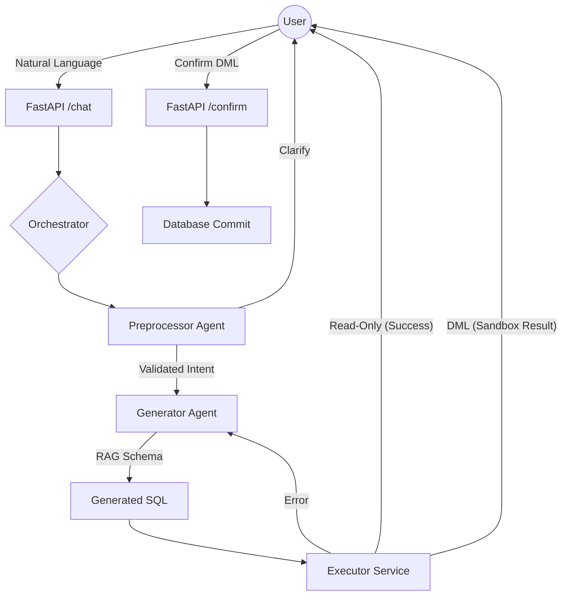

# Agentic NL-to-SQL Pipeline

A robust, multi-agent system designed to translate natural language into validated SQL queries with safe execution sandboxing and self-correction capabilities. 

Built with **FastAPI**, **Phidata**, and **Ollama**.

## � System Flowchart

The system follows a coordinated multi-turn dialogue flow to ensure accuracy and safety:



## 🚀 Key Features

- **Multi-Agent Coordination**: Orchestrates specialized agents for preprocessing, generation, and execution.
- **Dynamic Database Routing**: Ingest any SQLite database at runtime; the system automatically adapts its schema knowledge.
- **Safe DML Sandboxing**: INSERT/UPDATE/DELETE queries are executed in a transaction that is rolled back to show results before final user confirmation.
- **Persistent Chat History**: Session-based history stored in SQLite, allowing agents to handle multi-turn clarifications.
- **Self-Correction Loop**: If a generated query fails to execute, the orchestrator triggers a repair cycle (up to 2 retries).
- **Domain Restriction**: The Preprocessor strictly enforces that queries must relate to the connected database schema.

## �️ Project Structure

```text
app/
├── agents/
│   ├── preprocessor.py  # Intent normalization & clarification
│   ├── generator.py     # SQL generation (RAG-based)
│   ├── executor.py      # Safe SQL execution & sandboxing
│   ├── orchestrator.py  # Pipeline state management
│   ├── ingestion.py     # Schema introspection & KB loading
│   └── tools.py         # DB utility functions
├── api/                 # API route definitions
└── main.py              # FastAPI entry point
test_*.py                # Comprehensive test suite
.gitignore               # Cleaned for Git-safe commits
```

## 🏁 Quick Start

### 1. Requirements
- **Ollama**: Pull the required model: `ollama pull qwen2.5-coder:1.5b`
- **Python 3.10+**: Install dependencies via `pip install -r requirements.txt`

### 2. Run the Server
```bash
uvicorn app.main:app --reload
```

### 3. Usage Flow
- **Ingest**: `POST /ingest` with a `.sqlite` file to load a database.
- **Chat**: `POST /chat` with your `session_id` and nautral language query.
- **Confirm**: `POST /confirm` if the generated query was a DML statement requiring approval.

## � Security & Optimization
- **Temperature 0**: Deterministic LLM outputs for reliable SQL generation.
- **Schema Summarization**: Injects table summaries directly into prompts to minimize token overhead and network reliance.
- **Prompt Isolation**: System instructions are hidden from the user output.
